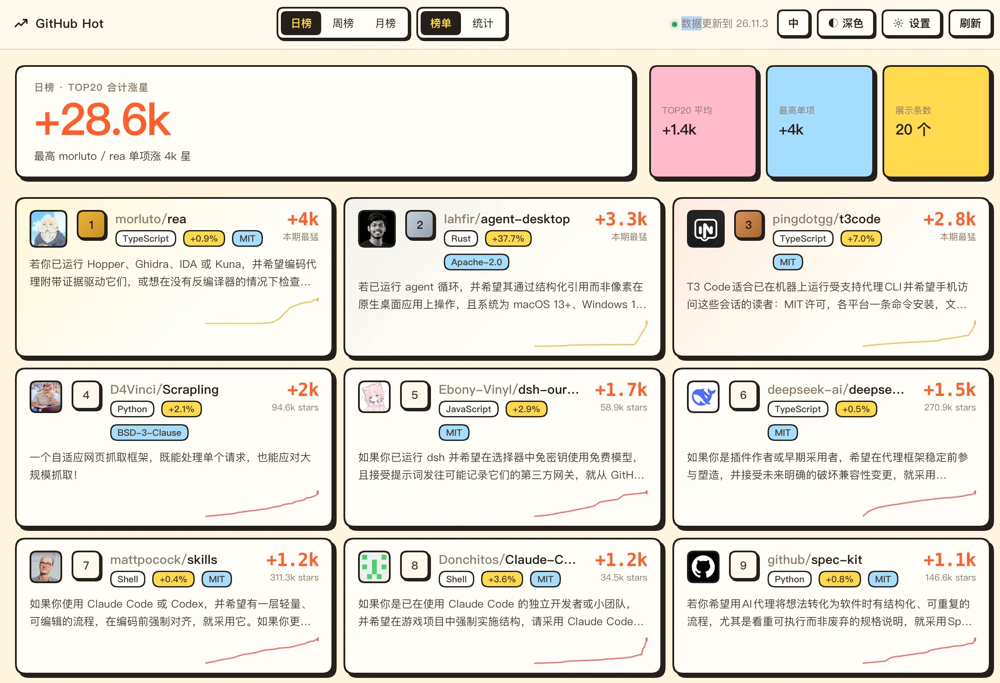
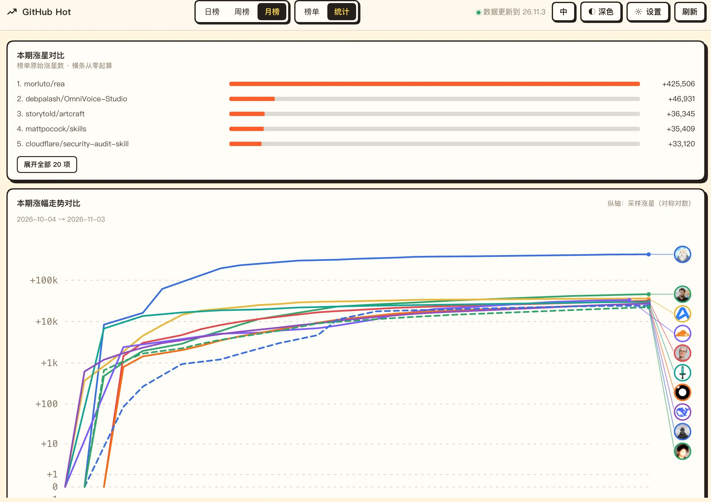

# dsh-github-hot

给 DeepSeek Harness 的 **GitHub 涨星榜**插件：日/周/月三榜切换，展示每期涨星 **TOP20**，主打可视化。





## 功能

- **日榜 / 周榜 / 月榜** 顶部一键切换，无需刷新页面
- **榜单视图**：每个项目一张卡片，含涨星数、名次徽章、语言与许可证标签、涨星曲线缩略图
- **详情**：点开任意项目，展示项目简介、星数历史曲线、期间涨星 / 起点星数 / 最新星数
- **统计视图**：日榜使用头像点图，每个项目一个点，按当日精确涨星数决定高低，不连线。周／月榜先用横条比较榜单原始涨星数（默认前 5 项，可展开全部），再对比周期内的采样曲线。纵轴随当前所选项目重算：同量级使用线性，非零末端涨幅的绝对值相差超过 10 倍时使用对称对数。末端头像自动避让，用引导线连接真实数据点；支持前 5、前 10、全选、清空
- **双主题**：深色（融入 DSH）与纸感贴纸风，右上角切换
- **新项目提醒**：首页显示最新日榜 TOP20 当天新增项目的数量与名称，点击名称可查看详情；与延续 3 天的 NEW 徽章分别计算。统计日期以卡片下方标注的日榜日期为准。
- **小白一眼看懂**：详情页曲线下方用一两句日常话直接说明「它能帮你做什么」，不再分用途和场景两节，标注由 DSH 模型生成。复用宿主默认模型，现有说明保持原样。当前页面按总星数选前 3 个项目，已有原始资料后按高星优先预热；主动查看优先于等待中的预热任务，不中断已经执行的任务。
- **取数提示**：首次拉取、手动刷新与后台更新都有状态条；后台更新时先保留已有快照，结束后自动更新并收起状态条，不常驻“已就绪”提示。取数失败会显示原因。
- **NEW 延续三天**：日榜沿用上游新增证据，首次记录到新增后，连续 3 个榜单自然日显示 NEW；周榜、月榜不标。不是项目创建日期，也不会把首次安装时的所有项目都算新增。
- **日榜遗珠**：替代原先的平均涨星、最高单项和展示条数卡片。持续收录实际观测到的日榜 TOP20，排除已经观测到进入周榜的项目。支持搜索、分页与项目详情；离开日榜仍保留，以后观测到进入周榜则移出合集。

## 数据来源

榜单数据来自 [Hysen Labs](https://hysenlabs.com) 的公开页面，无需 API key：

| 用途 | 地址 | 形式 |
|---|---|---|
| 日榜 / 月榜 | `/data/star-growth-24h.csv`、`/data/star-growth-30d.csv` | CSV |
| 周榜 TOP10 | `/weekly/{YYYY-MM-DD}` | HTML 解析 |
| 星数曲线 | `/chart/{slug}.svg` | SVG 路径解析 |
| 项目简介 | `/projects/{slug}` | HTML 解析 |

数据按 [CC BY 4.0](https://hysenlabs.com/ranking-methodology) 授权使用，界面底部与详情页均保留署名与外链。

## 安装

```bash
dsh plugin --profile desktop add dsh-github-hot
```

或从本地目录安装：

```bash
dsh plugin --profile desktop add /path/to/dsh-github-hot
```

安装后重启 DeepSeek Harness，左侧栏出现「GitHub Hot」入口。

## 行为说明

1. **取数失败不编造**：某榜单取不到时明确显示失败原因与快照时间，不会用旧数据冒充新数据。
2. **简介不编造**：没有对应分析时显示「暂无简介」，不使用模型生成内容替代原文。
3. **解析失败即报错**：周榜 HTML 或曲线 SVG 无法解析时整段标记失败，不做模糊推断。
4. **周榜依赖页面结构**：上游页面改版可能导致周榜失效，此时更新 `parseWeeklyHtml` 即可；日榜与月榜走 CSV，稳定性更高。
5. **曲线与榜单口径分开**：曲线数值由来源 SVG 还原，属于估算。每条线从期内首个可用采样日起算，图例显示起始日期；少于两个有效采样点不画线。精确的本期涨星以上方横条数值为准。
6. **英文模式不调用翻译模型**：榜单和项目详情都直接显示原文；中文模式使用宿主默认模型补译文。

## 缓存与请求频率

上游数据每天更新一次，因此缓存按自然日而非分钟设计：

| 内容 | 缓存位置 | 有效期 |
|---|---|---|
| 榜单 | 磁盘 `$DSH_HOME/dsh-github-hot/cache.json` | 跨自然日失效 |
| 项目详情与曲线 | 同上 | 跨自然日失效 |
| 简介中译、小白解释（独立版本键） | 磁盘 `zh.json` | 原文或解释提示词版本变更时重新生成；共用缓存容量上限 |
| 项目头像 | 磁盘 `avatars/`（上限 400） | 7 天 |
| 日榜观测史、NEW 日期及周榜出现记录 | 磁盘 `observations.json` | 长期保留，不随普通缓存过期 |
| 前端详情 | 浏览器 localStorage | 跨自然日失效 |

界面不做分钟级轮询，仅在页面跨过零点时静默刷新。出网请求按 host 分队列、限制并发，同一 URL 在途去重。

小白解释独立请求，不增加现有详情接口的等待；同项目同语言任务去重，单次后台任务最多等待 12 秒，前端等待 10 秒后提供重试。模型慢、不可用或资料不足时明确提示，不用原翻译冒充生成结果。模型输入包含项目完整名称和已提取的资料；不凭项目名称或模型记忆猜功能，不新增外部数据源。用途解释提示词已升级为 v2，旧版长篇解释不再命中缓存。

合集从本机已有的成功快照开始积累，后续每次成功取回榜单都会更新（含后台刷新）。没有打开面板、没有成功取回的数据不会补造；「尚未进入周榜」仅指本机未观测到，来源周榜目前只提供 TOP10。合集中的涨星数是最近上日榜时的历史值，不是当前涨星。

## 开发

```bash
npm ci      # 安装测试所需的 React 开发依赖
npm test    # 运行全部测试（部分用例会访问上游站点）
```

| 测试 | 覆盖内容 |
|---|---|
| `parsers` | CSV / 周榜 HTML / 曲线 SVG 解析（对线上真实响应） |
| `detail` | 项目页简介提取 |
| `client` / `render` | 浏览器半侧注册契约与首帧渲染 |
| `visual` | 真实组件 + 真实数据的同构渲染 |
| `baseline` | 多曲线对比的基准日计算 |
| `avatar` | 头像 CDN 获取与磁盘缓存 |
| `cache` / `uicache` / `persist` | 缓存命中、前端缓存与跨重启持久化 |
| `smooth` | 曲线平滑算法 |
| `timezone` | 多时区日期一致性 |
| `lang` | 语言切换行为 |
| `concurrency` | 按 host 的并发调度 |
| `hardening` | 路径穿越、CSV 边界、缓存结构校验 |
| `resilience` | 畸形输入下的降级行为 |
| `interactions` | 真实 React 交互：详情请求竞争、首次补译、快速切榜、连续跨天刷新、快捷选择、统计周期和掉星 |
| `routes` | 英文模式不调用模型、默认模型兼容、慢曲线补入缓存 |
| `observations` / `newbadge` / `swr` | 三天 NEW 边界、合集跨重启保存、周榜排除、后台刷新状态与退避 |

## 许可

MIT

小白解释的离线回归：`node --test test/explanation.mjs test/interactions.mjs`，覆盖默认模型调用、按总星数排序、主动查看优先、缓存失效与跨重启复用、异常输出与超时取消。
